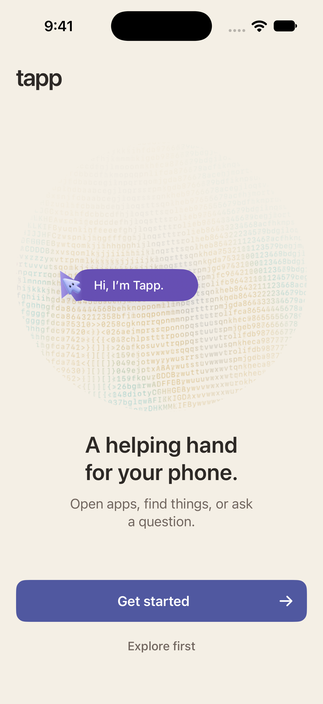
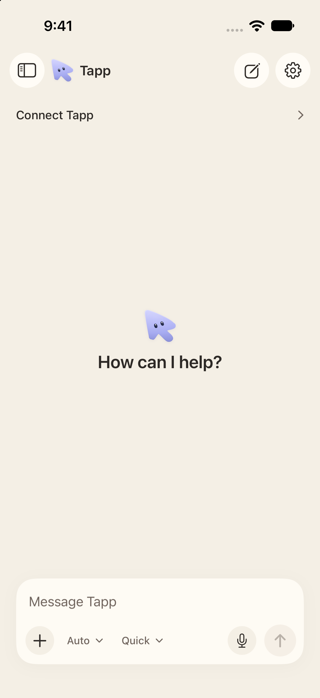
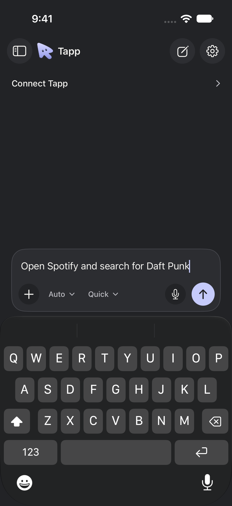

  

<strong>A voice assistant for your iPhone.</strong> Speak a request. Let Tapp find its way through the app.

  <a href="docs/appfusion/materials/tapp/demo-footage/Tapp-In-Action-Refined-Split.mp4">Watch the demo</a> ·
  <a href="docs/appfusion/materials/tapp/Tapp-AppFusion.pptx">View the pitch</a> ·
  <a href="docs/DEVELOPMENT.md">Build Tapp</a> ·
  <a href="docs/README.md">Explore the docs</a>

## Inside Tapp

Tapp explores how voice and AI can help people complete tasks across iPhone apps. In the recorded Spotify flow, it takes a spoken request, opens Spotify, enters “Daft Punk,” and checks the search results.

<table>
  <tr><th width="33%">Welcome</th><th width="33%">Home</th><th width="33%">Make a request</th></tr>
  <tr>
    <td></td>
    <td></td>
    <td></td>
  </tr>
</table>

*Screenshots: November 23 AppFusion simulator preview. The demo shows an October 30 physical iPhone run, with waiting time edited out. These represent the dated preview and recording, not a fresh verification of main.*

## Start exploring

| If you want to… | Start here |
| --- | --- |
| Understand the project | [AppFusion overview, pitch, and evidence](docs/appfusion/README.md) |
| Run or contribute to the app | [Mac and Windows development guide](docs/DEVELOPMENT.md) |
| Explore the visual direction | [Design library](design/README.md) |
| Review what was tested | [Consolidation status](docs/appfusion/STATUS.md) and [historical device checks](docs/appfusion/materials/tapp/README.md#verification-so-far) |
| Set up builds and distribution | [Cloud build guide](CI/README.md) |
| Report a beta issue | [In-app bug reporting](docs/DEVELOPMENT.md#reporting-a-bug-during-the-beta) |

## Repository map

| Location | Purpose |
| --- | --- |
| [PocketAgent/](PocketAgent/) · [PocketAgent.xcodeproj/](PocketAgent.xcodeproj/) | Main iOS app and Xcode project |
| [PocketAgentActivity/](PocketAgentActivity/) · [PocketNativeActivity/](PocketNativeActivity/) · [PocketControlTunnel/](PocketControlTunnel/) | Activity and device-control components |
| [Sources/](Sources/) · [Tests/](Tests/) · [Shared/](Shared/) | Core library, tests, and shared code |
| [Scripts/](Scripts/) · [DeveloperTools/](DeveloperTools/) · [CI/](CI/) | Development tools, build scripts, and CI |
| [design/](design/) | Visual references and standalone design studies |
| [docs/](docs/) | Development guidance, research, and AppFusion materials |

## Build and preview status

This is Jack and Lalith’s Tapp iOS repository. The hosted backend is maintained separately in a private repository. Main retains the internal project name **PocketAgent**. Open `PocketAgent.xcodeproj` with the `PocketAgent` scheme; run core tests with `swift test` from the repository root. See the [development guide](docs/DEVELOPMENT.md) for setup and dependencies.

The downloadable [AppFusion simulator preview](https://github.com/LALITH-GAUTAM/appfusion-hackathon/releases/tag/tapp-appfusion-preview) comes from the separate `appfusion-preview` branch, which uses `Tapp.xcodeproj`. Its branch, release, and verification history are documented in the [AppFusion collection](docs/appfusion/README.md#preview-and-source-branches). Live AI requires a privately supplied access code.

[Development notes](DEVELOPMENT_NOTES.md) and the [roadmap](ROADMAP.md) preserve engineering history. They include experiments and do not establish current device acceptance or App Store readiness.
