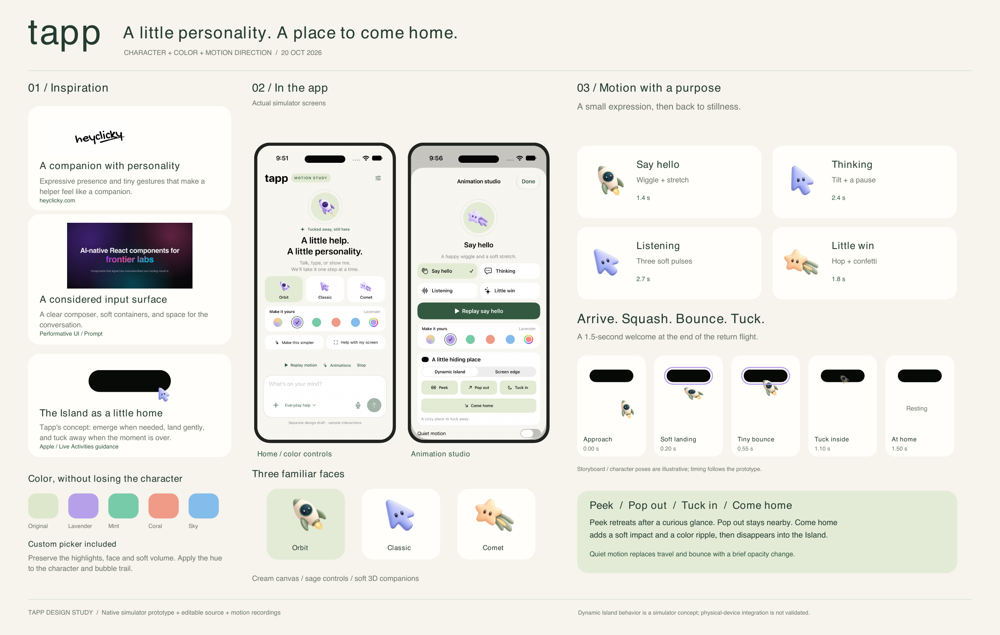

# Tapp character, color, and Island study

A native SwiftUI design preview with custom cursor colors, four expressive animations, and the Dynamic Island as the companion's hiding place. This is a separate simulator app, `com.jackadamslovell.TappColorStudy`.

## Start here

- [Visual design board](Board/tapp-design-board.pdf)
- [Board image](Board/tapp-design-board.png)
- [Full app UI](Previews/home.png)
- [Animation studio UI](Previews/studio.png)
- [Flight and Island arrival](Previews/island-arrival.mp4)
- [Expressions and Island controls](Previews/animation-studio.mp4)



## Preview behavior

The home screen has Orbit, Classic, and Comet, an Original palette, Lavender, Mint, Coral, Sky, and the native custom color picker. The selection persists across launches. Recoloring preserves the artwork's shading and alpha; the floating companion and its bubble trail use the selected hue.

Open **Animations** for:

| Expression | Behavior | Duration |
| --- | --- | --- |
| Say hello | Squash, stretch, and a small happy wiggle | 1.4 s |
| Thinking | Curious tilt, pause, and return | 2.4 s |
| Listening | Three gentle pulses and a fading ring | 2.7 s |
| Little win | Two small hops and a few confetti dots | 1.8 s |

Listening and thinking are visual demonstrations, not microphone or AI states.

The Dynamic Island is the default home. **Peek** comes out for a glance and retreats; **Pop out** stays nearby; **Tuck in** hides the companion; **Come home** returns with a visible soft landing. The return flight ends with a 1.5-second squash, small bounce, color ripple, and tuck into the Island. Screen-edge resting is also available.

Expressions use the same Core Animation implementation on the large studio character and the floating companion. Selecting an expression while tucked away brings the floating character out first. Quiet motion and system Reduce Motion suppress travel and expressive transforms. The external preview expires after three minutes; **Stop** ends it sooner.

## Run the native preview

Open `TappMotionStudy.xcodeproj`, choose the `TappMotionStudy` scheme, and run on the dedicated **Tapp Color Study** iPhone Air simulator:

```text
8B65F7CB-757A-43EA-BC00-A1A3A195E051
```

The renderer and helper deliberately accept only that simulator. On another Mac, create a dedicated iPhone Air simulator and replace the old identifier in the two explicit guards in `CompanionRuntime.m` and `DraftRocketRenderer.m` with its identifier. Keep both guards in place.

Validated build command on this Mac:

```sh
xcodebuild -project TappMotionStudy.xcodeproj \
  -scheme TappMotionStudy -configuration Debug \
  -sdk iphonesimulator \
  -destination 'id=8B65F7CB-757A-43EA-BC00-A1A3A195E051' \
  -derivedDataPath /tmp/TappColorStudyBuild build
```

This prototype uses simulator-only private display/input APIs inherited from the earlier motion study. It is not a shipping iPhone overlay or an ActivityKit implementation. Physical-device Dynamic Island integration remains separate work.

## Files

- `MotionStudy.swift`: home, palette controls, animation studio, and Island controls.
- `TappPreview.swift`: shared appearance and cached runtime-tinted artwork.
- `RocketTour.swift`: preview state and native view adapters.
- `DraftRocketRenderer.m`: motion, expressions, arrival, and Island rendering.
- `CompanionRuntime.m`: finite simulator companion process.
- `Characters.png`: original Tapp artwork, unchanged.
- `build_board.py`: editable board layout. Run with Python, ReportLab, and Pillow.

## Visual references

The board presents design takeaways, not claims of affiliation.

- [HeyClicky](https://www.heyclicky.com/): companion presence and expressive gestures. Reference wordmark from `https://www.heyclicky.com/assets/man-heyclicky-mark.avif`.
- [Performative UI / Prompt](https://performative-ui.cncl.co/#/components/prompt): composer hierarchy and input treatment. Reference image from `https://performative-ui.cncl.co/og.png`.
- [Apple Live Activities guidance](https://developer.apple.com/design/human-interface-guidelines/live-activities): platform reference for the Dynamic Island. The character's hiding-place behavior is a Tapp concept.
- The cream/sage treatment and Orbit, Classic, and Comet come from the supplied Tapp motion-study folder.

Third-party reference images retain their original ownership and are included as attributed inspiration in the design study.

## Validation

Built successfully for the iPhone Air simulator. Manually exercised preset and custom colors, persistence across relaunch, all four expression controls, peek/pop/tuck/come-home actions, normal flight arrival, and Quiet motion. Reviewed the UI, the recorded arrival, and the rendered board. See `Previews/validation.txt` for the final check notes.

The arrival recording uses Orbit; the studio recording uses Comet. The studio recording was captured before the final minor spacing adjustment; `studio.png` shows the final layout.
