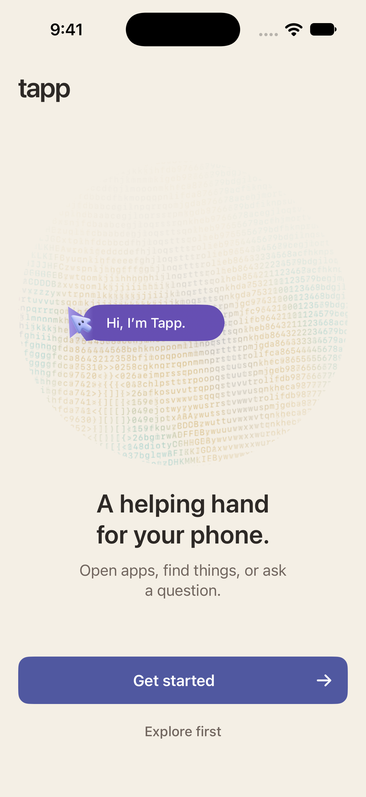
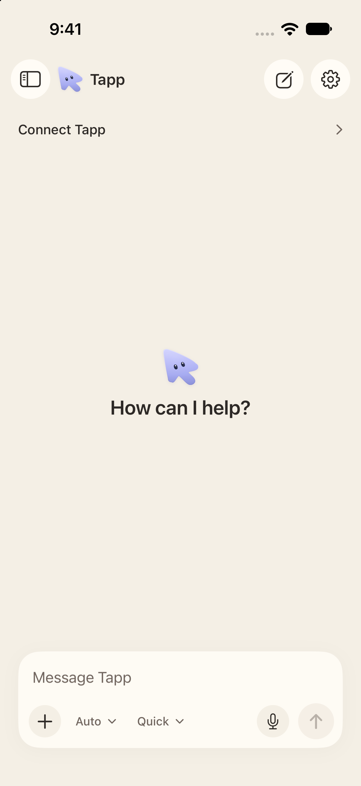
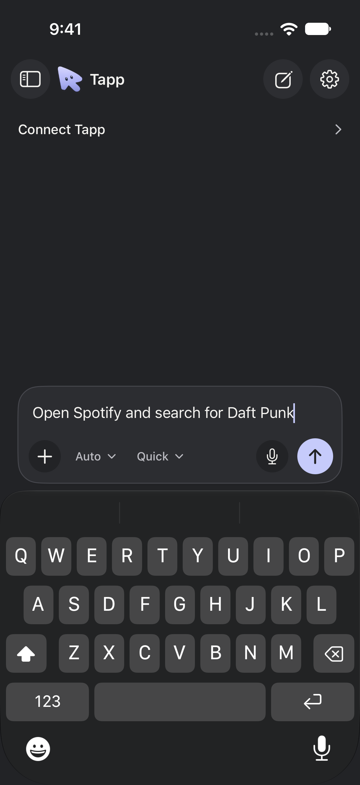

# 

**A voice assistant for your iPhone.** Ask Tapp to find an artist in Spotify. It opens the app, enters the name, and checks the results on screen.

[Try the iOS preview](tapp/README.md#download-and-run-tapp) · [Watch the 20-second demo](tapp/demo-footage/Tapp-In-Action-Refined-Split.mp4) · [View the pitch deck](tapp/Tapp-AppFusion.pptx)

## Inside Tapp

<table>
  <tr><th width="33%">Welcome</th><th width="33%">Home</th><th width="33%">Write a request</th></tr>
  <tr>
    <td></td>
    <td></td>
    <td></td>
  </tr>
</table>

All three screens are from the November 23 AppFusion simulator preview. The last shows an unsent request. The linked video shows the completed Spotify search on an iPhone using the October 30 interface.

## Team resources

[Submission notes and device checks](tapp/README.md)

<strong>Event schedule, submission checklist, and judging rubric</strong>

### Deadlines · Kamloops time

| When | What |
| --- | --- |
| Monday, Nov 23, 2026, 2:00 p.m. | Submit the project. Late entries are ineligible for judging. |
| Monday, Nov 23, 2026, 4:45 p.m. | Check in at Old Main, room OM 2791. |
| Monday, Nov 23, 2026, 5:00–7:00 p.m. | Presentations and awards. |

[Event page](https://aiclubtrusu.vercel.app/events/appfusion) · [Official student guide](https://aiclubtrusu.vercel.app/events/appfusion/guide) · [Submission form](https://aiclubtrusu.vercel.app/events/appfusion/submit)

### Build requirements

- [x] Select the audience, problem, and category. Tapp helps iPhone users who prefer voice input complete an in-app search hands-free.
- [ ] Build a mobile app that runs on a phone or emulator. An installable web app (PWA) qualifies.
- [ ] Implement one working core feature and at least one working AI feature that helps solve the problem as part of the app flow.
- [ ] Test the main flow, bad input, and connectivity or AI failures. Write down what changed after testing.
- [ ] If reusing an app or course project, document what existed before Nov 20 and what changed during the hackathon. Existing AI models and AI coding tools are allowed.

### Submission checklist

- [ ] Team name, both full names, and a contact email.
- [x] App name, category, and problem statement are in the [submission copy](tapp/README.md#submission-copy).
- [ ] What the AI feature does, its model or service, and what was built during the hackathon. Disclosing AI coding tools and their use is optional.
- [ ] Repo link that judges can view. This team repo starts private. Confirm judges can access the repo before submitting.
- [ ] One Google Drive folder with a **2–3 minute demo video**, **3–5 screenshots**, and optional slides. Set access to **Anyone with the link can view** and test the links in a private window.
- [ ] Submit by **2 p.m.** The form allows resubmissions before the deadline and uses the latest entry.

### Presentation and judging

You have **5 minutes total**, including the recorded demo, followed by **2 minutes of Q&A**. Organizers play the submitted files. Use the demo to show the working core feature and the AI in one flow. Be ready to explain why the AI belongs in the app, how it was tested, and its limits.

| Criterion | Points |
| --- | ---: |
| Core functionality and AI | 15 |
| Usefulness | 10 |
| Usability and accessibility | 5 |
| Creativity | 5 |
| Presentation and demonstration | 15 |

[Full judging rubric](https://aiclubtrusu.vercel.app/events/appfusion/guide#criterion-A)

