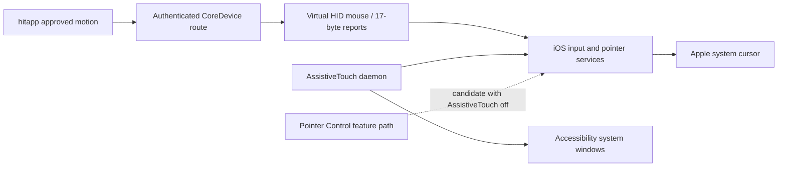

# AssistiveTouch reverse engineering for hitapp

## Latest UI decision: HeyClicky reference; PiP rejected

The owner explicitly wants the same UI as HeyClicky: a small floating buddy/cursor with nearby conversation UI. The physical iPhone must display it across apps with AssistiveTouch OFF. A video window does not meet this requirement.

The physical PiP experiment displayed over hitapp and Settings, then was stopped after the owner's rejection. `device-pip-rejected-events.json` records playback pause, audio-session deactivation and PiP stop; the five accessibility/feature getters remained false. Its source is archived in TappLab's `RejectedExperiments/PictureInPicture` and excluded from the active build. The active probe's background-audio declaration has been removed. This is a rejected mechanism, not successful Tapp delivery. All earlier physical renderer/pointer failures below remain unresolved. The cleaned signed probe installed as sequence **3744**. Offline inspection also saved `phone-axui-service-checker.json` and `phone-axui-service-checker.asm.txt` from the exact phone-build AccessibilityUIService image. Symbols include per-message entitlement checking and a service-specific unentitled-message decision; no usable custom-overlay message or runtime success was established. External branch labels in extracted-cache disassembly are not authoritative. This candidate remains unproven, not a universal impossibility result.


Research date: 2026-10-18, America/Vancouver. Latest status: cross-app custom rendering verified in the isolated simulator with AssistiveTouch off; normally signed physical-phone rendering failed. The physical native-HID off-state comparison also produced no verified movement. The follow-ups below supersede the initial read-only scope and historical ON-baseline instructions.

## Physical pointer-service combinations — 21:44 follow-up

The owner unlocked the phone and both pending mechanisms were exercised without changing AssistiveTouch. First, `PSPointerClientController` visibility and keep-alive assertions ran alongside the existing Fast / 10-second mouse loop. Second, `PSPointerSystemClientController` also requested pointer-scene preparation for the phone's display configuration. Both loops completed **334 native reports and three local captures, with no hover, feedback steering or target arrivals**. Each research run recorded ten observations at visibility 0, interaction state 0, interaction disabled and position `{0, 0}`. Added delegate callbacks captured no state transitions. Fresh in-flight captures show no cursor. This is further negative evidence for these particular routes, not proof that every possible route is impossible.

Evidence: [assertion-plus-HID summary](../../../DeveloperTools/TappLab/Evidence/device-combined-20261018-2141-summary.json) and [scene-plus-HID summary](../../../DeveloperTools/TappLab/Evidence/device-scene-combined-20261018-2144-summary.json). These link via their file fields to raw app events, the native result, the frame, and the after-state check, with hashes. The first assertion interval was 21:40:56–21:41:27; the second was 21:43:41–21:44:10. The native report lacks per-report timestamps, so exact overlap duration is not independently established. The first console attachment timed out after 12 seconds while the app continued logging normally; use the complete app JSON. After the second cleanup, the state-only launch intentionally terminated the old process, explaining signal 9 in that console.

Mac preview was disconnected during the motion intervals. Both runs recorded explicit assertion invalidation/releases and client invalidation; the second requested scene invalidation. A returned scene request is not proof of scene activation. Native results verify owned mouse removal and connection closure. All five accessibility/feature getters remained false, including the final physical check at 21:44:33. No XCTest, physical click, feature override or entitlement change was used.

The separate signed probe is installed as sequence **3728**. Simulator lifecycle checks for [state callbacks](../../../DeveloperTools/TappLab/Evidence/20261018-214027-pointer-service-cleanup/result.json) and [scene preparation](../../../DeveloperTools/TappLab/Evidence/20261018-214301-pointer-scene-cleanup/result.json) passed, without a visibility pass. The offline inspector also saves the exact phone's pointer-client callback/getter and scene prepare/invalidate disassembly. Production hitapp source is unchanged. The remaining work requires a different physical rendering/input mechanism; unlock is no longer the blocker, and the simulator character is not a phone implementation.

## Physical off-state comparison — 20:00 follow-up

The owner requested a working demonstration followed by continued implementation. Recorded [a new simulator demonstration](../../../DeveloperTools/TappLab/Evidence/tapp-live-demo-20261018-195639.mp4), then continued on the physical phone once it was available. Its main hitapp agent was idle; production sources were not changed.

The independent Tapp Research app now has a read-only `--state-only` entry point. Physical checks at 19:58:33 and 20:00:24 returned false for **AssistiveTouch, Dwell, Pointer Control, AXAction and AXAction_PointerControl**. This measures the exact phone's runtime gates, superseding the earlier unmeasured-state caveat. This launch does not create a UIKit scene or renderer, but `devicectl --no-activate` still disturbed foreground presentation; do not use it mid-test or during personal use.

Between those checks, the unchanged hitapp loop ran at **Fast / 30 seconds** using the existing motion-only native 17-byte descriptor. Dwell-off acknowledgement was based on the getter. The UI's old AssistiveTouch-on wording was deliberately not followed; AssistiveTouch stayed OFF. Stopped Device Hub screen sharing during the 8-second countdown and verified its disconnected screen before native movement.

The [result](../../../DeveloperTools/TappLab/Evidence/device-native-pointer-off-20261018.txt) records **1,015 reports, 9 local captures, hover false, 0 steering commands and 0 arrivals**, with temporary mouse removal verified, connection closed and activity ended. The [saved in-flight frame](../../../DeveloperTools/TappLab/Evidence/device-native-pointer-off-20261018.png) shows no cursor and an unknown pointer location with 3 seconds remaining. Dispatch succeeded; visible motion did not pass. Manual Stop, hand visibility during movement and physical clicking were not separately exercised or confirmed. The baseline ON result remains historical; AssistiveTouch was not turned back on.

Evidence: [before states](../../../DeveloperTools/TappLab/Evidence/device-state-only-20261018.txt), [after states](../../../DeveloperTools/TappLab/Evidence/device-state-after-native-off-20261018.txt). This supplies case B, previously listed as unrun. It does not establish that every alternate pointer mechanism is impossible.

At this checkpoint, the next hypothesis was native HID combined with Apple pointer visibility/keep-alive assertions. Added `--pointer-service` to the separate phone probe: no custom drawing, no input, no settings writes; read-only position/visibility/interaction observations; assertions released at Stop, 45 seconds or background expiration. The phone locked before that combined test could run. **The 21:44 follow-up above supersedes this pending status.** Do not extend these probes into an unbounded background service.

## Tapp cross-app renderer follow-up

The owner requested continued implementation, called the cursor **Tapp**, asked for a cute appearance, and explicitly prioritized operation across apps with AssistiveTouch OFF. Source and reproducible probes are saved in [TappLab](../../../DeveloperTools/TappLab/README.md); this is not yet the completed phone feature.

### Runtime findings

- **Isolated iPhone Air simulator, iOS 27.0 / 24A434:** a standalone `CAContext` with displayable/display-ID/non-hit-testing options renders our mint face over Settings, another app and Home. It moves and parks centrally. [A capture 70 seconds after switching out](../../../DeveloperTools/TappLab/Evidence/20261018-184216-layer-idle/home-after-70-seconds.png) still shows it after background-task expiration. [Recorded getters](../../../DeveloperTools/TappLab/Evidence/20261018-184216-layer-idle/events.json) report AssistiveTouch, Pointer Control and Dwell false. No input is dispatched. The external runner terminates the process; this is a measured interval, not permanent operation.
- **Physical iPhone Air, iOS 27.2 / 24B5089g:** installed the independent ordinary developer-signed **Tapp Research** app. Both [remote](../../../DeveloperTools/TappLab/Evidence/device-renderer-properties-console.txt) and [local](../../../DeveloperTools/TappLab/Evidence/device-renderer-local-context-console.txt) CAContext constructors returned valid objects, but requested display ID 1 read back as 0. A [foreground capture](../../../DeveloperTools/TappLab/Evidence/device-renderer-foreground-off.png) shows no mint character. Context creation is not successful display attachment.
- **Simulator native pointer service:** keep-alive and show assertions returned objects; position stayed `{0, 0}`, visibility state 0 and interaction false. Explicitly preparing the system pointer scene did not improve those observations. That experimental run did not log normal cleanup. Later inspection of its 18:48:48 crash report identified `BSSimpleAssertion dealloc` trapping when the live assertion was released. The bounded runner attempted termination, but did not establish normal cleanup. Both probes now explicitly invalidate assertions before releasing them; a separate lifecycle runner covers this regression. Do not promote assertion creation to a visibility pass.

The current phone setting is **AssistiveTouch OFF**, visually checked and corroborated by the research app getter; Dwell and Pointer Control getters were also OFF. This supersedes historical ON-baseline instructions in the earlier report. Further phone interaction stopped when it entered personal use. No additional personal-app captures or actions were performed after that observation. Production hitapp sources and its native input path were not changed. The separate research app remains installed, with its renderer cleaned up; newer diagnostics were built without reinstallation.

### Exact phone-build signing gate

Read the cached iPhone18,4 / 27.2 (24B5089g) `QuartzCore` and `libAccessibility` images from Xcode DeviceSupport, without contacting the phone. [Image hashes, UUIDs, addresses and decoded constants](phone-symbols.json), [QuartzCore disassembly](phone-quartz-gates.asm.txt), and [accessibility disassembly](phone-accessibility-gates.asm.txt) are saved. Reproduce using:

```sh
python3 Scripts/inspect_tapp_phone_symbols.py \
  --symbols "$HOME/Library/Developer/Xcode/iOS DeviceSupport/iPhone18,4 27.2 (24B5089g)/arm64e/Symbols" \
  --output docs/research/assistivetouch-2026-10-18
```

The recovered chain is specific:

1. `CA::Render::Server::audit_token_cache_lookup` queries a 17-entry entitlement table at `0x1e05cbbc0` and assigns result bits by table index. Index **1** is `com.apple.QuartzCore.displayable-context`.
2. `__XRegisterClient` obtains that caller mask at `0x184415300`. Instructions `0x1844154e4`–`0x1844154ec` translate its bits 1/2 into the constructor permission bits 0/1, and bit 11 into permission bit 2. It passes that derived mask into `CA::Render::Context` at `0x184415508`.
3. The constructor reads the `displayable` option (CFString object `0x1e22170e0`). At `0x184413464`, it skips the displayable flag unless permission bit **0** is set. When permitted and requested, it sets context flag `0x4000`.
4. `CA::WindowServer::Server::context_created` checks that context flag before selecting a display and adding the context. Asking for `displayId: 1` alone does not supply the permission.

Our signed diagnostic has ordinary application/team/debug entitlements, without the displayable-context entitlement. **Inference:** this recovered authorization path explains the physical display-ID-0 result and why simulator success does not transfer to the developer-signed phone. No ungranted entitlement was added, no OS process was patched, and no platform identity was impersonated. This analysis does not establish that every conceivable global visual surface is impossible; it establishes the tested direct CAContext route's restriction.

The extracted cache's disassembler sometimes labels external branch destinations with an unrelated nearby local symbol. Those labels are not evidence of external call identity; the argument/bit trace above relies on instructions and symbols within QuartzCore.

### Pointer Control gate and next handoff

On the cached phone image, `_AXSPointerControlEnabled` (`0x18fbfdd2c`) and `_AXSPointerControlSetEnabled` (`0x18fbfded0`) both check the AXAction and AXAction_PointerControl runtime flags. If the gates fail, the getter returns false and the setter returns without applying the preference change. That explains why calling the setter is not a viable proof of enabling the feature. Static inspection does **not** tell us which runtime flag values the physical device currently returns. The latest uninstalled diagnostic reads both flags explicitly for a future measurement.

The main-agent follow-up can reuse these files without merging anything into hitapp: run `layer-idle` on the dedicated simulator, inspect the screenshots, or build the `TappDeviceProbe` scheme. Its latest UI distinguishes an unattached context from a visible renderer, records display ID during movement, handles Stop before delayed startup, and bounds background lifetime. It does not change settings or send input.

The unresolved physical experiment is the existing authenticated CoreDevice native mouse with AssistiveTouch off, followed by independent movement/input/cleanup evidence if it succeeds. Do not treat the simulator native-service failure as a physical native-HID result. The phone was in use, so this work did not perform that comparison. The cute artwork is ready; cross-app input, physical global drawing, idle persistence beyond the measured simulator interval, rotation, lock/reboot and battery behavior remain open.

## Initial investigation (historical scope)

**Recommendation:** test the existing CoreDevice virtual mouse against iOS's separate Pointer Control path before attempting to replace Apple's cursor renderer. A custom cursor inside hitapp is buildable. A custom, always-visible cursor over other apps has no demonstrated route under hitapp's current signing privileges. Removing the AssistiveTouch toggle dependency may nevertheless be possible using Apple's existing pointer service; this is a concrete experiment, not a completed feature.

The owner requirement remains: a real pointer across apps and between tasks, centred when idle; AssistiveTouch eventually off; the hand activity retained during control; no XCTest Automation Running screen. A foreground drawing, hidden AssistiveTouch menu, or longer timer does not meet it.

## What was actually inspected

- Local source: `PocketPointerProbe.swift`, `PocketNativeEngine.swift`, and `NativeControlModel.swift`; current roadmap and saved physical-test metadata.
- Apple's installed simulator `AssistiveTouch.app/assistivetouchd`, iOS 27.0 build 24A434 and iOS 27.1 build 24A94425. Read Mach-O sections, imported symbols, private framework dependencies, strings, and ARM64 disassembly. No Apple executable was modified or launched.
- Signed entitlements of the local physical-device PocketAgent build. It has the packet-tunnel entitlement and normal development identity/debug entitlements, not the global pointer/window privileges listed below.
- Public UIKit SDK header `UIPointerInteraction.h`, and current Apple documentation linked below.

The project records the phone as iOS 27.2. **Neither simulator executable is that physical phone's executable.** This work establishes architecture and a testable lead; it does not establish phone behavior, service authorization, or background persistence. No phone connection, setting change, input, capture, installation, or XCTest launch was performed in this investigation.

Reproduce the binary inspection from the project root:

```sh
python3 Scripts/inspect_assistivetouch.py --output docs/research/assistivetouch-2026-10-18
```

The script reads available installed simulator runtimes and saves selected evidence only. It does not boot them. Generated files include original binary paths, SHA-256 hashes, Mach-O UUIDs, selected embedded entitlements/imports/strings, and addressed disassembly excerpts:

| Runtime | Evidence | Binary UUID |
| --- | --- | --- |
| iOS 27.0 | [Metadata](iOS-27-0.json), [disassembly](iOS-27-0-pointer-control.asm.txt) | `92A3CD9A-1E32-3F07-B0AD-AA781330D053` |
| iOS 27.1 | [Metadata](iOS-27-1.json), [disassembly](iOS-27-1-pointer-control.asm.txt) | `860E945E-FB09-3E59-89F9-D3F5AF5E95A3` |

## Architecture recovered

This is a component map inferred from imports, names and the existing proven HID route, not a fully recovered Apple call graph:



The binary contains `HNDSystemPointerController`, `HNDSystemPointerStreamObserver`, `HNDMousePointerAppearance`, `HNDVirtualHIDMouse`, `HNDEventManager`, `HNDDisplayManager`, and `HNDWindow`. Imported classes include `BKSMousePointerService`, `HIDVirtualEventService`, `AXSpringBoardServer`, `AXUIDaemonWindow`, and `AXUIDaemonNonInteractiveWindow`.

It links private `BackBoardServices`, `PointerUIServices`, `AccessibilityPhysicalInteraction`, `AccessibilityUIUtilities`, and `AssistiveTouchUI` frameworks. Relevant selectors include `requestGlobalMouseEventsForDisplay:displayID:targetContextID:`, `currentAbsoluteSystemPointerPoint`, `resetSystemPointerToPoint:`, `moveSystemPointerIfActiveToPoint:onDisplay:`, and `_updateAutoHideMousePointer`. Selectors demonstrate available implementation vocabulary; they do not prove that calling a selector from hitapp would succeed.

Apple separates input routing, cursor position/appearance, accessibility menu windows, and display/orientation handling. The menu bubble is not the cursor. Our native engine currently supplies mouse reports; it does not supply the system renderer.

## Strongest new lead: independent Pointer Control gate

In **both inspected runtimes**, the function beginning at unslid address `0x10002a750` branches as follows, reconstructed directly from the saved instructions:

```text
if AXRuntimeCheck_AXAction_PointerControl():
    if AXSPointerControlEnabled():
        return true
    return AXSDwellControlEnabled() != 0
else:
    return AXSAssistiveTouchEnabled() && !UIAccessibilityIsSwitchControlRunning()
```

This is pseudocode for an unnamed boolean function; its Objective-C method identity was not resolved. We do not claim it is definitively `canShowASTMousePointer`. A separate display-manager-area branch at `0x10000dd4c`–`0x10000dd9c` accepts Scanner, AssistiveTouch, **or a feature-gated Pointer Control state**. These are stronger evidence than merely finding a setting name in strings.

**Inference:** a separate Apple pointer path may support the virtual mouse with AssistiveTouch off when the runtime feature is enabled. The boolean alone does not prove cursor visibility, device eligibility, routing of our virtual device, click handling or persistence. Keep Dwell Control off; its presence in the branch is not a reason to enable automatic clicking.

Apple's [iOS 27 iPhone pointer guide](https://support.apple.com/en-sg/guide/iphone/iphec6e1e60b/27/ios/27) documents Settings → Accessibility → Pointer Control, including auto-hide, size and colour. Its linked [AssistiveTouch guide](https://support.apple.com/en-sg/guide/iphone/iph96b21954/27/ios/27) still describes AssistiveTouch-based mouse setup. The documentation does **not** itself establish that our virtual mouse works with AssistiveTouch off. Treat the UI options as a route to inspect on the exact phone build, not proof that the new path is enabled there.

## Why copying the renderer is a different project

Both simulator binaries embed these selected entitlements in `__TEXT,__entitlements`:

| Capability suggested by entitlement | Exact key |
| --- | --- |
| Accessibility window hosting | `com.apple.springboard.accessibility-window-hosting` |
| Global pointer event routing | `com.apple.backboardd.global-pointer-event-routing` |
| Pointer repositioning | `com.apple.backboardd.pointerRepositioning` |
| HID event dispatch / filtering / monitoring | `com.apple.private.hid.client.event-dispatch`, `.event-filter`, `.event-monitor` |
| Display context / occlusion override | `com.apple.QuartzCore.displayable-context`, `com.apple.QuartzCore.occlusion-override` |
| Platform process and sandbox profile | `platform-application`, `seatbelt-profiles = [assistivetouchd]` |

These are embedded simulator entitlement declarations. `codesign -d --entitlements :-` returned an empty dictionary for the simulator binary; the collector therefore explicitly extracts the Mach-O section. This is not a verified entitlement dump from the physical phone, nor a proof that every listed entitlement is required for every individual call.

The current signed hitapp build lacks these privileges. Apple's [runtime security description](https://support.apple.com/en-ca/guide/security/sec15bfe098e/web) explains the sandbox and entitlement boundary, and [TN2415](https://developer.apple.com/library/archive/technotes/tn2415/) explains how signing/provisioning authorizes capabilities. Adding strings to our entitlement file does not grant Apple's privileges. Developer installation also does not by itself grant them.

The public [`UIPointerInteraction` delegate](https://developer.apple.com/documentation/uikit/uipointerinteractiondelegate/pointerinteraction(_:regionfor:defaultregion:)) and the installed SDK provide view-local regions, positions and pointer styling. [`UIWindowScene`](https://developer.apple.com/documentation/uikit/uiwindowscene) manages our app's windows. These do not expose the global window-hosting and repositioning mechanisms above. Therefore a SwiftUI/UIKit custom cursor can implement the visual design inside hitapp, but cannot be presented as completion of the cross-app requirement.

## Current engine: reusable pieces and missing pieces

| Area | Verified or implemented | Missing for the roadmap |
| --- | --- | --- |
| Movement | Native 17-byte report, ID 5, signed X/Y bytes 1/2; motion-only descriptor; owned device verification and removal | AssistiveTouch-off movement on the exact phone build |
| Physical evidence | Saved 30-second Fast result: 1,144 reports, 9 captures, 317 feedback commands, 4 target arrivals; roadmap records owner confirmation | No new physical test in this research |
| Input | Separate native touchscreen path exists; pointer descriptor has no buttons and zeroes button fields | An independently approved successful input test with AssistiveTouch off; mouse clicking would require a separately reviewed report/descriptor change |
| Localisation | Fresh hover feedback inside the app; relative HID units deliberately treated as non-pixel units | Reliable cross-app position feedback and rotation mapping; screenshots showing a cursor are not yet a cursor detector |
| Lifecycle | Foreground checks, 10/30/45-second windows, media authentication, route and owned-device cleanup | Background lifetime, pointer lifetime after disconnect, stop while backgrounded, lock/reboot recovery |
| Idle centring | No global absolute positioning implementation | Observed global location and a verified recenter strategy; do not integrate relative deltas as pixel coordinates |

Relevant source locations: `DeveloperTools/rork-device/Sources/RorkDevice/CoreDevice/PocketPointerProbe.swift` (`motion`, `creation`), `PocketNativeEngine.swift` (`probePointerMovement`, `startMedia`), and `PocketAgent/Services/NativeControlModel.swift` (`startPointerExperiment`, scene-phase and disappearance cancellation). The test metadata is `DerivedData/NativeControlV2/pointer-fast-30s-20261018.txt`.

Deleting the timers or foreground checks would only remove protections; it would not prove persistence. iOS normally suspends background apps, as described in Apple's [background execution guidance](https://developer.apple.com/documentation/uikit/extending-your-app-s-background-execution-time). The Dynamic Island hand is a separate activity surface, not a grant of global drawing or indefinite execution. A packet-tunnel entitlement is likewise not evidence that the app's pointer loop can run indefinitely.

## Build decision and next physical experiment

| Approach | Decision |
| --- | --- |
| Rebuild menu/cursor visuals inside hitapp | Feasible; useful visual prototype, does not satisfy global cursor requirement |
| Keep current AssistiveTouch-backed mouse | Preserve working baseline; fails eventual dependency-removal requirement |
| Existing native engine + Apple's separate Pointer Control path | **First experiment.** Concrete static evidence, no physical pass yet |
| Ship our own global renderer under current signing | No demonstrated route; private service/entitlement boundary is unresolved |
| Privileged research-device implementation | Separate deployment model; not evidence of feasibility on the owner's normally signed phone |

The smallest informative experiment is a bounded comparison on the exact phone build. It should use the existing native report format, same virtual device descriptor, same movement, and no Mac mirror/XCTest. Change only the pointer setting being tested. Record settings visually before and after; the existing owner preference is AssistiveTouch ON and Dwell OFF, so restore that baseline after any explicitly arranged temporary off test.

| Case | AssistiveTouch | Separate Pointer Control, if available | What it answers |
| --- | --- | --- | --- |
| A | On | Record current state | Reconfirm known physical movement baseline |
| B | Off | Off / unavailable | Does this build already render ordinary native pointer input? |
| C | Off | On | Does the candidate path remove the AssistiveTouch toggle dependency? |

Record actual visible motion, hover receipt separately, hand activity, no Automation Running screen, Stop response, owned-device removal and media/route cleanup. A successful send count is not a pass. Do not silently re-enable AssistiveTouch and call B/C successful.

Only after a motion pass, test one deliberate approved native input against an inert owned control with AssistiveTouch off. Keep this result distinct from mouse-button support. Then create a dedicated bounded cross-app lifecycle experiment with an independently reachable stop, capture scope, and verified app/lock observations; the current foreground lab cannot perform that test unchanged. Measure cursor visibility while idle and after registration/media teardown, then background duration, phone-only route survival, rotation, centring error, lock/unlock and battery use. Test Apple's auto-hide setting before considering periodic motion; continuous jitter would neither centre the pointer nor prove a sound lifecycle.

If C works, we can pursue a hitapp-controlled **Apple system pointer without AssistiveTouch enabled**. It still depends on Apple's pointer service and does not establish arbitrary hitapp cursor artwork over other apps. If C fails, retain the result and investigate the native service/device gating before building a custom renderer. The full always-visible, centred, cross-app milestone remains open in either case until its physical acceptance tests pass.

## Main-agent execution handoff

The owner requested this file handoff on 2026-10-18 and said they will have the main agent test it. This research chat has finished; physical testing belongs to that follow-up. There is no new phone build to install from this research: only this report, the roadmap update, the inspection script and saved evidence were added.

1. Read the current roadmap and coordinate the phone test with the owner in the main chat. Confirm the actual iOS build and current settings; the simulator's feature gate may differ. Preserve the latest voice/navigation work in the shared project.
2. Inspect Settings → Accessibility → Pointer Control. Record the controls actually available. Do not assume an enable switch exists merely because the binary has `AXSPointerControlEnabled`; auto-hide/appearance controls alone do not prove the candidate path can be enabled independently. If unavailable, mark case C unavailable rather than writing private preferences.
3. Use the existing motion-only native pointer lab for A/B/C above, with the same speed, duration and report descriptor in each comparable run. Keep Dwell off, the physical phone unlocked in the lab, Mac preview disconnected during movement, and XCTest stopped. The UI's existing AssistiveTouch instruction describes the old baseline; any diagnostic wording change must remain limited to this experiment and must not assert off-state support before a pass.
4. Observe the physical cursor and hand indicator, then check Stop, owned-mouse removal and media/route cleanup. Log motion, hover events and successful report dispatch separately. Restore AssistiveTouch ON / Dwell OFF and any other settings changed for the experiment, unless the owner has since changed their preference.
5. Save dated results beside this report and update the roadmap with the observed outcome. Only proceed to approved inert-target input after an off-state motion pass. Cross-app persistence and centring need their own experiment; retain the existing foreground and duration limits in this first test.

Result record — main-agent physical test, 2026-10-18, approximately 18:24 local:

Case A ran on the existing installed build (sequence 3656), without installing the separate, unverified mouse-click prototype. Before the run, Settings visibly showed AssistiveTouch ON and Dwell Control OFF. Settings search returned no result for “Pointer Control”; this is not yet a complete inspection of the Accessibility list and does not prove the independent gate is unavailable. The Mac preview was disconnected before the movement countdown elapsed. A later process check found no XCTest runner executable or PocketControlTunnel process; the old iCTRL host and activity extensions were present, which is distinct from an active XCTest runner.

The app recorded real hover feedback, but the final saved frame says pointer/target feedback was unavailable and movement paused near the end. Dispatch counts are not physical-motion proof. The owner subsequently confirmed “pointer did move” and mentioned a separate non-accessibility test; hand visibility and absence of the Automation Running screen were not specifically reconfirmed for this run. While reconnecting after cleanup, Device Hub reported a video-stream timeout and then switched externally to the newly appearing “Tapp Lab — iPhone Air” simulator. Phone interaction was paused to avoid competing with another session.

At approximately 18:26 the owner said Device Hub was free and authorized continuing. The physical phone was reselected; Dwell OFF and AssistiveTouch ON were visually reverified. During the attempt to toggle AssistiveTouch off, Device Hub again switched externally to the Tapp Lab simulator, now displaying its separate in-app movement demo. A cleanup-only physical-phone inspection at approximately 18:27 confirmed AssistiveTouch was still ON; no restoration was needed. Case B has not started. Pause the competing Device Hub session before resuming; do not treat simulator flags or its drawn pointer as evidence of physical off-state support.

| Evidence | A: baseline | B: AssistiveTouch off | C: off + separate Pointer Control |
| --- | --- | --- | --- |
| Exact iOS build and settings | iOS 27.2 (24B5089g); AssistiveTouch ON, Dwell OFF | Not run | Separate control not fully inspected |
| Same speed / duration / descriptor | Fast / 30 seconds / existing motion-only 17-byte descriptor | Not run | Not run |
| Visible physical cursor movement | Owner confirmed movement | Not run | Not run |
| Hover feedback / reports sent (separate observations) | Hover true; 1,010 reports; 9 local captures; 73 steering commands; 1 arrival | Not run | Not run |
| Hand visible / no Automation Running | Owner observation pending; no XCTest runner executable found | Not run | Not run |
| Stop / owned-device removal / media and route cleanup | Normal timed completion; owned mouse removal verified; diagnostic reports connection closed and icon ended; tunnel process absent. Manual Stop not exercised | Not run | Not run |
| Settings restored and evidence path | Baseline unchanged: ON / OFF. `DerivedData/NativeControlV2/pointer-ab-A-on-20261018.txt` and `.png` | Not run | Not run |

Do not mark the full roadmap milestone complete from A/B/C alone. It additionally requires deliberate input, cross-app visibility, idle centring and lifecycle verification.
